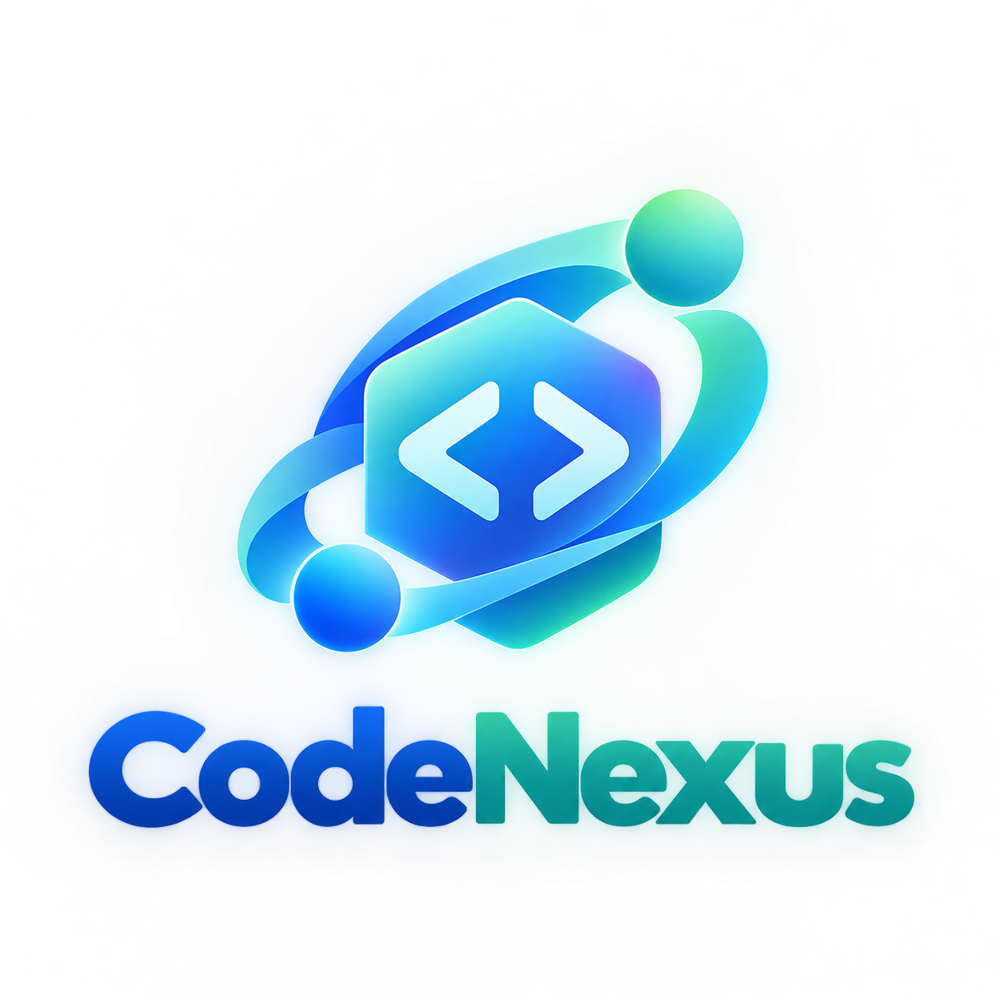

English | [中文](README_CN.md)

<div align="center">



[](https://www.rust-lang.org/) [](https://www.rust-lang.org/) [](https://crates.io/crates/codenexus) [](https://crates.io/crates/codenexus) [](https://github.com/Kirky-X/codenexus/actions/workflows/ci.yml) [](LICENSE)

**A multi-language code knowledge graph tool built on LadybugDB and tree-sitter**

[✨ Key Features](#-key-features) • [🚀 Quick Start](#-quick-start) • [📚 Documentation](#-documentation) • [💻 Examples](#-examples) • [🤝 Contributing](#-contributing)

</div>

---

<div align="center">

### 🎯 Index once, query the whole repo

Run `codenexus index` once and symbol relationships land in the graph — every question after that goes to the graph:

<table style="width:100%; border-collapse: collapse">
<tr>
<td align="center" width="25%">⚡<br><b>Incremental pipeline</b><br><span style="color:#64748B">hash diffing · reparse only changes</span></td>
<td align="center" width="25%">🕸️<br><b>Property graph</b><br><span style="color:#64748B">45 node types · 32 edge types · Cypher</span></td>
<td align="center" width="25%">🧭<br><b>Multi-hop tracing</b><br><span style="color:#64748B">call chains · data flow · taint paths</span></td>
<td align="center" width="25%">🔌<br><b>Dual entry</b><br><span style="color:#64748B">39 CLI commands + serve mode · 11 MCP tools</span></td>
</tr>
</table>

</div>

---

## 📋 Table of Contents

<details open>
<summary>📑 Table of Contents</summary>

- [✨ Key Features](#-key-features)
- [🚀 Quick Start](#-quick-start)
- [🛠️ CLI Commands](#️-cli-commands)
- [🔌 MCP Integration](#-mcp-integration)
- [📚 Documentation](#-documentation)
- [💻 Examples](#-examples)
- [🏗️ Architecture](#️-architecture)
- [🧪 Testing](#-testing)
- [📊 Performance](#-performance)
- [🔒 Security](#-security)
- [🗺️ Roadmap](#️-roadmap)
- [🤝 Contributing](#-contributing)
- [📋 Changelog](#-changelog)
- [📄 License](#-license)
- [🙏 Acknowledgments](#-acknowledgments)
- [📞 Contact & Support](#-contact--support)
- [⭐ Star History](#-star-history)

</details>

---

## ✨ Key Features

<table style="width:100%; border-collapse: collapse">
<tr>
<td width="50%" style="vertical-align:top; padding: 12px">🌐 <b>Multi-language parsing</b><br><span style="color:#64748B">The default <code>full</code> preset supports 22 languages (C, Rust, Fortran, Python, TypeScript, Go, Java, C++, JavaScript, Ruby, Haskell, OCaml, Scala, PHP, C#, Bash, HTML, CSS, JSON, Regex, Verilog, Swift); trim it down with <code>lang-*</code> features</span></td>
<td width="50%" style="vertical-align:top; padding: 12px">🕸️ <b>Graph database</b><br><span style="color:#64748B">LadybugDB graph storage with 45 node types + 32 edge types, queryable via a Cypher subset</span></td>
</tr>
<tr>
<td width="50%" style="vertical-align:top; padding: 12px">🔄 <b>Incremental indexing</b><br><span style="color:#64748B">SHA-256 file hash comparison re-parses only changed files; Rayon parallelism + thread-local parser pool</span></td>
<td width="50%" style="vertical-align:top; padding: 12px">💾 <b>RAM-first indexing</b><br><span style="color:#64748B">LZ4-compressed in-memory sources with a single <code>COPY FROM</code> bulk load (<code>--ram_first</code>)</span></td>
</tr>
<tr>
<td width="50%" style="vertical-align:top; padding: 12px">🔍 <b>Symbol tracing</b><br><span style="color:#64748B">Bidirectional call-chain (Calls) and data-flow (DataFlows) tracing; cross-language multi-hop taint path tracing (<code>TaintPathTracer</code>)</span></td>
<td width="50%" style="vertical-align:top; padding: 12px">🎯 <b>Impact analysis</b><br><span style="color:#64748B">Change blast-radius analysis, layered by depth, with multi-edge-type dimensions + risk assessment</span></td>
</tr>
<tr>
<td width="50%" style="vertical-align:top; padding: 12px">🧩 <b>Ambiguity resolution & confidence tiers</b><br><span style="color:#64748B">Multi-match symbols are resolved by ranked confidence; every edge carries a tier (SameFile / ImportScoped / Global) + 0.0-1.0 score</span></td>
<td width="50%" style="vertical-align:top; padding: 12px">📐 <b>Architecture diagrams</b><br><span style="color:#64748B"><code>diagram</code> compiles the architecture into a self-contained interactive HTML (deterministic layout / orthogonal routing / dark & light themes / source-evidence badges)</span></td>
</tr>
<tr>
<td width="50%" style="vertical-align:top; padding: 12px">🆚 <b>Architecture semantic delta</b><br><span style="color:#64748B"><code>arch_diff</code> compares two indexed projects, emitting Before/Delta/After HTML + a machine receipt (added/removed/changed + JSON Pointer fields)</span></td>
<td width="50%" style="vertical-align:top; padding: 12px">🧾 <b>Diagnostic receipts</b><br><span style="color:#64748B">Errors and warnings emit structured receipts (stable rule codes + evidence + actionable fixes); symbol ambiguity / stale index / truncated results all ship repair hints</span></td>
</tr>
<tr>
<td width="50%" style="vertical-align:top; padding: 12px">🔗 <b>Cross-language FFI</b><br><span style="color:#64748B">C-Fortran bind(C), Rust extern, and other cross-language call resolution</span></td>
<td width="50%" style="vertical-align:top; padding: 12px">📦 <b>Team artifacts</b><br><span style="color:#64748B"><code>export</code> / <code>import</code> compressed <code>.cnxp</code> artifacts for sharing indexes</span></td>
</tr>
<tr>
<td width="50%" style="vertical-align:top; padding: 12px">🤖 <b>Multi-agent MCP</b><br><span style="color:#64748B"><code>setup</code> auto-detects Claude Code / Cursor / Codex; <code>skill</code> one-command skill-doc sync to Agent global directories; <code>hook</code> emits PreToolUse/PostToolUse JSON; <code>mcp</code> stdio server exposes 11 tools with parameter semantics in each tool description; <code>ask</code> routes natural-language entry to existing commands</span></td>
<td width="50%" style="vertical-align:top; padding: 12px">👁️ <b>File watching</b><br><span style="color:#64748B">Daemon mode with automatic incremental indexing (<code>daemon</code> feature, graceful SIGTERM/SIGINT shutdown)</span></td>
</tr>
<tr>
<td width="50%" style="vertical-align:top; padding: 12px">🚦 <b>CI & architecture gates</b><br><span style="color:#64748B"><code>ci</code> risk gates (<code>--fail_on</code> exit codes + PR Markdown, with an official GitHub Action); <code>lint</code> custom Cypher rule packs (<code>.codenexus/rules.json</code>)</span></td>
<td width="50%" style="vertical-align:top; padding: 12px">🛡️ <b>Security & supply chain</b><br><span style="color:#64748B"><code>taint</code> automated auditing with a built-in five-language source/sink rule library; <code>supply</code> external dependencies in the graph (ExternalPackage/DEPENDS_ON) as a supply-chain view</span></td>
</tr>
<tr>
<td width="50%" style="vertical-align:top; padding: 12px">📈 <b>Architecture evolution</b><br><span style="color:#64748B"><code>evolve</code> replays the last N commits: worktree snapshots indexed one by one, producing a metrics timeline JSON + inline SVG sparkline HTML</span></td>
<td width="50%" style="vertical-align:top; padding: 12px">📦 <b>Artifact ecosystem</b><br><span style="color:#64748B"><code>hub</code> push/pull/list (protocol v1, token or <code>CODENEXUS_HUB_TOKEN</code>); <code>skill</code> one-command skill-doc sync to Agent global directories; <code>ask</code> natural-language entry</span></td>
</tr>
<tr>
<td width="50%" style="vertical-align:top; padding: 12px">🧮 <b>Analysis toolkit</b><br><span style="color:#64748B">Dead-code detection (worklist reachability + confidence), architecture overview, complexity analysis (8 metrics), community detection (Leiden), cross-service call chains</span></td>
<td width="50%" style="vertical-align:top; padding: 12px">🧠 <b>Vector embeddings</b><br><span style="color:#64748B">Semantic search enabled by default (<code>embeddings</code> feature, local Candle inference + BM25 full-text)</span></td>
</tr>
<tr>
<td width="50%" style="vertical-align:top; padding: 12px">🌍 <b>Internationalization</b><br><span style="color:#64748B">Unicode case folding + NFC normalization (ICU4X, <code>i18n</code> feature, included in the <code>full</code> preset)</span></td>
<td width="50%" style="vertical-align:top; padding: 12px">🧰 <b>LSP enrichment</b><br><span style="color:#64748B">7 LSP clients (rust-analyzer, pyright, clangd, gopls, ts-lang-server, fortls, jdtls) provide type-accurate resolution beyond tree-sitter (<code>lsp</code> feature)</span></td>
</tr>
</table>

Beyond the core capabilities above, CodeNexus also ships `context` assembly (`--budget <N>` caps the token budget; omitting it disables truncation), `detect_changes` change detection, `rename` rename-impact pre-checks, `ask` natural-language entry, `ci`/`lint` architecture gates, `taint` taint auditing, `supply` supply-chain view, `evolve` evolution replay, `hub` artifact client, `skill` skill sync, oxcache-backed query-result caching, and structured logging via inklog; the grouped list of the 39 subcommands (plus the `mcp` serve mode) lives in the [🛠️ CLI Commands](#️-cli-commands) section, and per-command flag semantics with runnable examples are in the [📖 User Guide · Command Reference](docs/en/USER_GUIDE.md#️-command-reference).

---

## 🚀 Quick Start

### 📦 Installation

```bash
# Install from crates.io (default full preset, all 22 languages + all features)
cargo install codenexus
```

Requires Rust 1.97.1 or later (MSRV, matching `rust-version` in `Cargo.toml` and `msrv` in `clippy.toml`; the CI toolchain is currently pinned to 1.97.1, see `.github/workflows/ci.yml`).

> **Link failure troubleshooting** (openEuler / CentOS and other GCC ≤ 12 systems): see the [❓ FAQ · Installation & build](docs/en/FAQ.md#-installation--build).
>
> **Source builds, per-language trimming, and the full feature list**: see the [📖 User Guide · Build presets and feature flags](docs/en/USER_GUIDE.md#-build-presets-and-feature-flags).

### 💡 Minimal example

The following commands are adapted from [`examples/src/bin/basic_indexing.rs`](examples/src/bin/basic_indexing.rs) and other examples plus the [📖 User Guide](docs/en/USER_GUIDE.md), and run out of the box:

```bash
# 1. Index a repository (the database defaults to .codenexus/<project>.lbug)
codenexus index --path /path/to/project --name myproject

# 1b. RAM-first indexing (LZ4 in-memory compression + single bulk load; recommended for
#     repos with ≥ 1 GB of source, ADR-024; measured to use more memory on small repos,
#     falls back to streaming disk reads when the memory budget would be exceeded)
codenexus index --path /path/to/project --name myproject --ram_first true

# 2. Query functions (Cypher subset)
codenexus query --cypher "MATCH (f:Function) RETURN f.name LIMIT 10"

# 3. Trace call chains (optional flags have built-in defaults: depth=5, no path filter)
codenexus trace --symbol main --trace_type calls

# 4. Search symbols (exact / regex / fuzzy + BM25 full-text; limit defaults to 50)
codenexus search --text "parse" --mode exact
codenexus search --text "authentication logic" --fulltext true
```

> 💡 **Tip**: add `.codenexus/` to your project's `.gitignore` (the index database and logs both live there). You can also create `.codenexus/config.json` to pin per-project defaults (e.g. `ram_first`, complexity thresholds) — see the [📖 User Guide · Configuration](docs/en/USER_GUIDE.md#️-configuration-file).

---

## 🛠️ CLI Commands

CodeNexus ships **39 subcommands** (plus the `codenexus mcp` serve mode), grouped by function:

- **Indexing & project management**: `index` / `daemon` / `status` / `list` / `clean` / `export` / `import`
- **Query & search**: `query` / `search` / `source` / `context`
- **Tracing & impact analysis**: `trace` / `impact` / `detect_changes` / `rename`
- **Analysis toolkit**: `dead_code` / `architecture` / `complexity` / `community` / `cross_service` / `verify`
- **API review & diagrams**: `route_map` / `shape_check` / `api_impact` / `tool_map` / `diagram` / `arch_diff`
- **Security & gates**: `taint` / `supply` / `ci` / `lint`
- **Artifacts & agent ecosystem**: `hub` / `skill` / `ask` / `evolve`
- **Multi-agent & LSP**: `setup` / `hook` / `lsp_goto_def` / `lsp_hover`

With the `webui` feature enabled, an additional **`webui`** subcommand starts the embedded graph-viewer Web UI in one command (see the [📖 User Guide · Embedded Web UI](docs/en/USER_GUIDE.md#️-embedded-web-ui-graph-viewer)). Every command is also available through the **`cn`** alias (same CLI surface as `codenexus`, e.g. `cn webui`, `cn index ...`).

Full flag semantics and runnable examples for every command are in the [📖 User Guide · Command Reference](docs/en/USER_GUIDE.md#️-command-reference); complexity metrics and thresholds in the [📖 User Guide · Complexity Analysis](docs/en/USER_GUIDE.md#-complexity-analysis), dead-code configuration in the [📖 User Guide · Dead Code Detection](docs/en/USER_GUIDE.md#-dead-code-detection).

---

## 🔌 MCP Integration

CodeNexus uses [sdforge](https://crates.io/crates/sdforge) to provide an MCP (Model Context Protocol) server exposing **11 tools** (`query` / `trace` / `impact` / `search` / `source` / `context` / `architecture` / `diagram` / `arch_diff` / `dead_code` / `detect_changes`) over the sdforge `mcp` stdio transport. The tools share the same `#[forge]` definitions as the identically named CLI commands; each tool description documents its parameter semantics and defaults, and the server opens the database read-only so it can run alongside a writer. For startup, onboarding, and hook commands, see the [📖 User Guide · Multi-Agent Integration](docs/en/USER_GUIDE.md#-multi-agent-integration).

---

## 📚 Documentation

<details>
<summary>📋 Table</summary>

| Document | Description |
| -------- | ----------- |
| [📖 User Guide](docs/en/USER_GUIDE.md) | Complete tutorial from installation to advanced usage (incl. complexity analysis and dead-code detection) |
| [📘 API Reference](docs/en/API_REFERENCE.md) | Library crate public API, facades, and CLI/MCP external interfaces |
| [⚡ Performance Guide](docs/en/PERFORMANCE.md) | Benchmark suite, measured baselines, SLOs, and the L1–L7 memory defenses |
| [🔒 Security](docs/en/SECURITY.md) | Security policy, vulnerability reporting, and best practices |
| [❓ FAQ](docs/en/FAQ.md) | Frequently asked questions |
| [🧪 Test Scenario Matrix](docs/en/TEST_SCENARIOS.md) | Scenario matrix exhaustively derived from the real test suite |
| [📋 Changelog](docs/en/CHANGELOG.md) | Release-by-release changes (Keep a Changelog format) |
| [🚀 Release Checklist](docs/en/RELEASING.md) | Pre-release doc-number reconciliation checklist |
| [🤝 Contributing](docs/en/CONTRIBUTING.md) | How to contribute to the project |
| [📜 Code of Conduct](docs/en/CODE_OF_CONDUCT.md) | Community code of conduct |
| [🔬 Research Notes](docs/research/) | Paper notes: TaintRadar, cascaded vulnerability chains |
| [🛡️ Security Audits](docs/security/) | Strix audit triage with a ReDoS false-positive proof |
| [🤖 CLI Skill](skill/SKILL.md) | Agent-facing CLI usage knowledge pack (verified against v0.4.0-rc.2) |
| [📈 Benchmark Notes](benches/README.md) | Criterion benchmark suite and SLO threshold table |
| [📦 crates.io](https://crates.io/crates/codenexus) | Publication page |

</details>

---

## 💻 Examples

All 14 runnable examples live in [`examples/`](examples/) (the full table and run commands are in the [📖 User Guide · Examples](docs/en/USER_GUIDE.md#-examples)). Examples index source with `IndexFacade`, query with `QueryFacade`, and trace calls with `TraceFacade`; the full library API is documented in the [📘 API Reference](docs/en/API_REFERENCE.md).

---

## 🏗️ Architecture

CodeNexus is a dual-target "library + binary" crate: `src/lib.rs` exposes the public API (model / parse / storage / index / query / trace / service modules) and `src/main.rs` is the sdforge-driven CLI binary; since v0.3.2 the CLI and MCP interfaces are unified through the sdforge `#[forge]` macro inside `src/service/`, where each command defines a core function + CLI wrapper + MCP wrapper. Indexing flows through "file discovery → incremental hashing → parallel parsing → symbol resolution → bulk load".

The three-layer source structure, pipeline diagram, graph model (45 node / 32 edge types with confidence tiers), per-language extraction table, and the output semantics of `architecture` / `diagram` / `arch_diff` live in the [📖 User Guide](docs/en/USER_GUIDE.md).

---

## 🧪 Testing

Layered strategy: inline `#[cfg(test)]` unit tests in `src/` → integration tests in `tests/` → acceptance tests in `tests/acceptance/` over 8 real open-source projects (cross-validated against gitnexus) → 7 Criterion benchmark groups in `benches/` for regression guarding. The layer overview, CI-identical execution commands, the exhaustive scenario matrix, and the statistics summary live in the [🧪 Test Scenario Matrix](docs/en/TEST_SCENARIOS.md).

---

## 📊 Performance

The benchmark suite is 7 Criterion groups in `benches/`; the L1–L7 memory defenses cut index peak memory on a 70 GB host from ~60 GB to ~4 GB. The full measured baseline, SLO table, and tuning recipes are in the [⚡ Performance Guide](docs/en/PERFORMANCE.md); the SLO threshold table in [`benches/README.md`](benches/README.md).

---

## 🔒 Security

Security design, supply-chain gates, and the vulnerability reporting policy are in the [🔒 Security doc](docs/en/SECURITY.md). Do not report security vulnerabilities through public issues — use the GitHub [Security Advisories](https://github.com/Kirky-X/codenexus/security/policy) private disclosure channel as the primary route.

---

## 🗺️ Roadmap

Completed areas and planned enhancements (as of v0.4.0) are in the [📋 Changelog · Roadmap](docs/en/CHANGELOG.md#️-roadmap).

---

## 🤝 Contributing

For the detailed contribution process and code standards, see the [🤝 Contributing Guide](docs/en/CONTRIBUTING.md).

- 🐛 [Report a Bug](https://github.com/Kirky-X/codenexus/issues/new)
- 💡 [Suggest a Feature](https://github.com/Kirky-X/codenexus/issues)
- 🔧 [Submit a PR](https://github.com/Kirky-X/codenexus/pulls)

---

## 📋 Changelog

The full release history lives in the [📋 Changelog](docs/en/CHANGELOG.md) (following the [Keep a Changelog](https://keepachangelog.com/en/1.1.0/) format, semantic versioning).

---

## 📄 License

This project is licensed under the [MIT](LICENSE) license.

---

## 🙏 Acknowledgments

### 🌟 Core dependencies

CodeNexus stands on the shoulders of these excellent open-source projects:

<details>
<summary>📋 Table</summary>

| Dependency | Purpose |
| ---------- | ------- |
| [lbug](https://github.com/ladybugdb/ladybugdb) (LadybugDB) | Graph database storage |
| [tree-sitter](https://tree-sitter.github.io/) + 22 grammar crates | Multi-language AST parsing |
| [rayon](https://github.com/rayon-rs/rayon) | Data parallelism |
| [notify](https://github.com/notify-rs/notify) / notify-debouncer-full | File watching and debouncing |
| [sdforge](https://crates.io/crates/sdforge) | CLI + MCP dual-transport framework (`#[forge]` macro) |
| [trait-kit](https://crates.io/crates/trait-kit) | Capability registry |
| [oxcache](https://crates.io/crates/oxcache) | Query result cache |
| [inklog](https://crates.io/crates/inklog) | Log backend (console + daily-rotating file sink; inklog is pulled in with `default-features = false`, and `full` builds compile the zstd compression backend through vecboost's `inklog/compression` feature, so rotation files are zstd-compressed) |
| [vecboost](https://crates.io/crates/vecboost) | Local Candle embedding inference |
| [ICU4X](https://github.com/unicode-org/icu4x) (icu_normalizer / icu_casemap) | Unicode normalization and case mapping |
| [petgraph](https://github.com/petgraph/petgraph) | Community-detection graph algorithms |
| [criterion](https://github.com/bheisler/criterion.rs) | Benchmarking |

</details>

### 💝 Special thanks

Thanks to the Rust community and all [contributors](https://github.com/Kirky-X/codenexus/graphs/contributors).

---

## 📞 Contact & Support

<table style="width:100%; max-width: 600px">
<tr>
<td align="center" width="33%">
<a href="https://github.com/Kirky-X/codenexus/issues"><b style="color:#991B1B">Issues</b></a><br>
<span style="color:#64748B">Report problems and bugs</span>
</td>
<td align="center" width="33%">
<a href="docs/en/FAQ.md"><b style="color:#1E40AF">Docs / FAQ</b></a><br>
<span style="color:#64748B">Please check here before asking</span>
</td>
<td align="center" width="33%">
<a href="https://github.com/Kirky-X/codenexus"><b style="color:#1E293B">GitHub</b></a><br>
<span style="color:#64748B">Browse the source</span>
</td>
</tr>
</table>

---

## ⭐ Star History

[](https://star-history.com/#Kirky-X/codenexus&Date)

If this project helps you, please consider giving it a ⭐️!

**Built by Kirky.X**

---

<sub>© 2026 Kirky.X. All rights reserved.</sub>
